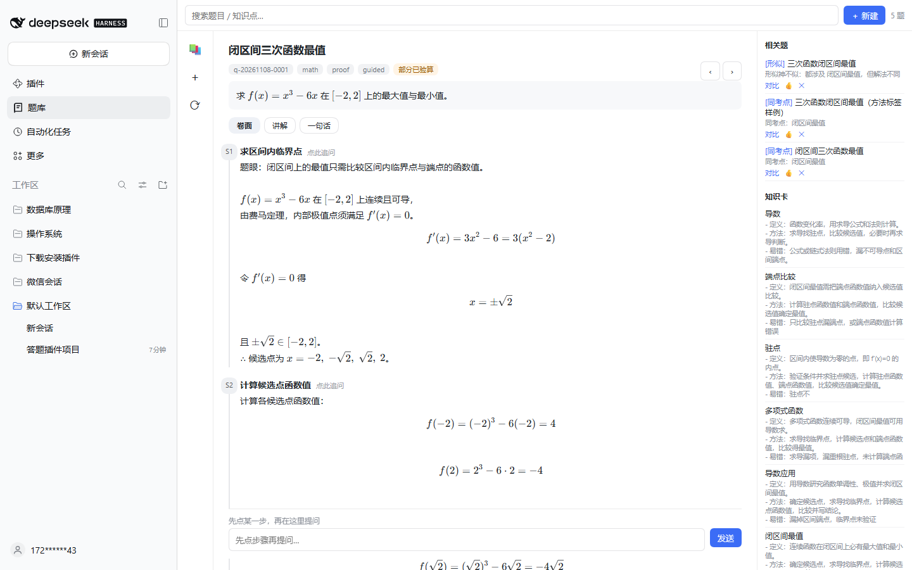
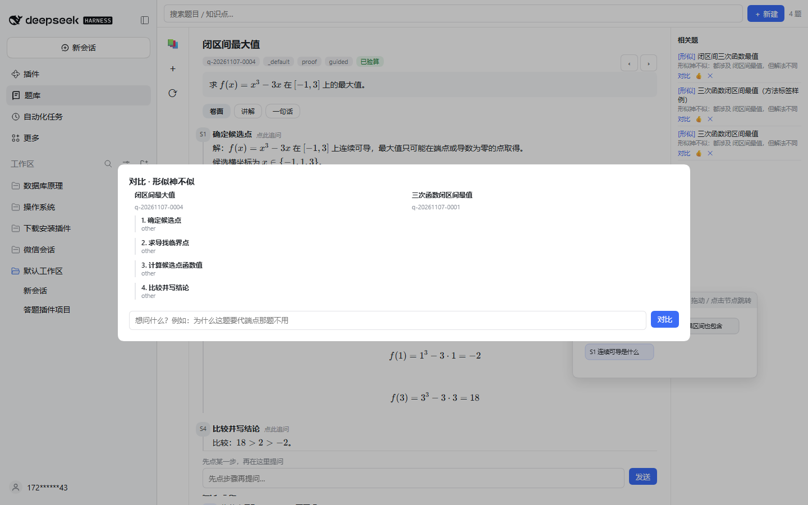
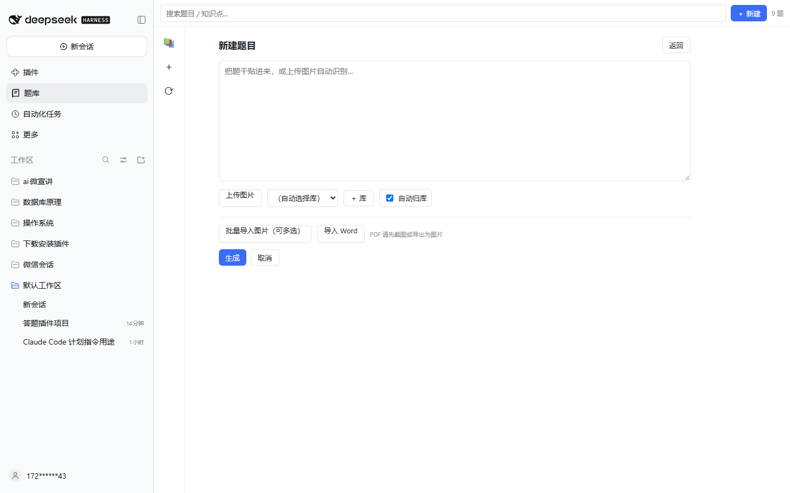

# dsh-studygo

给 [DeepSeek Harness](https://github.com/deepseek-ai) 用的**学习题库**插件：把"问一道题"从一次性聊天，变成可沉淀、可追问、可关联的知识库。



## 解决的问题

| 痛点 | 这个插件的做法 |
|---|---|
| AI 答题步骤不清 | 强制按"步骤骨架"输出：每步有 做什么 / 为什么 / 卷面写法 |
| 要么太长要么太死板 | 一份答案三层：**卷面**（可直接抄）、**讲解**（为什么）、**一句话**（快速回忆） |
| 追问要重述上下文 | 点任意一步 → 底部输入框 → 追问挂在**那一步**上，可继续追问形成树 |
| 追问答完就丢 | 追问永久随题保存，树状结构可视化、可点击跳转、可拖动 |
| 题目之间没联系 | 自动算三类关系：**同套路 / 同考点 / 形似神不似**，可并排对比、可屏蔽 |
| 题库越堆越乱 | 每个库一份可编辑的**知识卡**（定义/方法/易错），做题时自动引用相关题 |

## 功能现状

- **答题**：proof / analysis 两种形态；数学、线代、物理、化学、生物、英语、语文、计科、自控、工科通用共 11 套课程包
- **三层答案**：卷面 / 讲解 / 一句话，KaTeX 渲染（行内 `$...$`、独立 `$$...$$`、`\(...\)`、`\[...\]` 都认）
- **追问树**：节点-连线图，可拖、可点击定位并高亮对应的追问条目
- **库与记忆**：知识卡（模型生成、可手改）、三类相关题、对比视图与对比追问、👍/✕（可恢复）
- **录入**：粘贴、单图上传 + OCR（Windows 自带）、批量多选 + **一页多题自动切分**、Word（.docx，纯 JS 解析）、跨页"并入上一条"
- **归库**：自动归库（按相似题 + 库的主导课程判断），无合适库时可新建，库名相似会提示
- **管理**：库合并、跨库检索（FTS5 中文二元组）、数据库索引自愈



## 安装

```bash
# 1. 放到 DSH 的插件目录（或任意位置后用 junction/软链）
npm install /path/to/dsh-studygo

# 2. 在 profile 里挂载：~/.dsh/profiles/<name>/package.json
{
  "dsh": { "profile": { "bundles": ["dsh-studygo"] } }
}

# 3. 重启 DSH
```

侧边栏会出现「题库」入口。

## 配置

在 profile 配置里可覆盖（都有默认值）：

| 键 | 默认 | 说明 |
|---|---|---|
| `vault` | `~/.dsh/study-vault` | 题库根目录（普通 Markdown，可迁移、可 Git 管理）；也可用环境变量 `DSH_STUDY_VAULT` 指定 |
| `provider` | `deepseek-account` | 模型提供方 |
| `model` | `deepseek-flash` | 模型 |

## 数据在哪

题库是一个**纯 Markdown 目录**，不锁死在数据库里：

```
~/我的题库/
  数学-导数/
    index.md          # 库信息 + 知识卡
    q-20261107-0001.md  # 一道题：frontmatter + 题干/步骤/追问
  附件/2026-11-08/     # 上传的原图
  .meta/links.json     # 关联反馈（屏蔽 / 赞）
  .index/study.db      # FTS5 检索索引（可删，会重建）
```

## 已知限制

- **PDF 不支持直接导入**：请先截图或导出为图片（没有可靠的纯 JS 文本抽取）
- **切题靠题号规则**：无题号、靠排版分题的教辅可能切不开（可手动编辑队列文本）
- **成本**：每道题一次模型调用，约 1–2 万 token；批量导入时按题数线性增长
- **仅同库关联**：跨库关联暂未做
- Windows 优先（OCR 用 `Windows.Media.Ocr`；其它平台会跳过 OCR）



## 开发

```
lib/
  index.js     插件入口（配置、路由挂载）
  host.js      HTTP API：库/题/检索/生成/导入
  store.js     Markdown 读写（frontmatter、题目、知识卡）
  index-db.js  SQLite FTS5 检索（中文二元组）
  solve.js     生成管线（骨架 + 风格 + 公式校验重试）
  relations.js 三类关系计算
  llm.js       模型调用与重试
  courses.js   课程包加载与判科
  docx.js      .docx 纯 JS 解析
  client.js    浏览器面板（无构建，手写 bundle）
courses/*.yml   课程包
scripts/        截图、sympy 验算、OCR
```

## License

MIT
